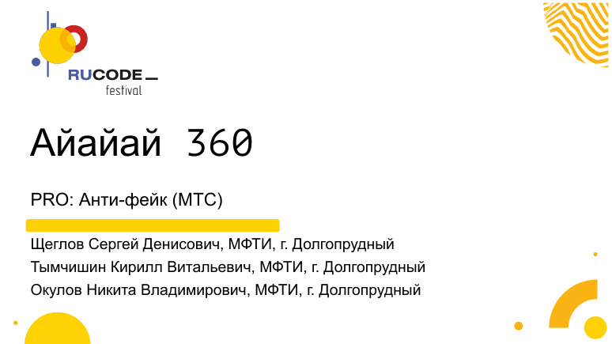

# RuCode AI 2026 · PRO: Анти-фейк

**Задача C от МТС · Команда «Айайай 360»**

Как отличить синтетическую речь от настоящей по короткой аудиозаписи? Мы сравнили признаки звуковой волны, разные представления спектра и аугментации. В финале оставили две свёрточные сети на спектрограммах полной записи.

[](presentation.pdf)

**[Финальная защита (PDF)](presentation.pdf) · [Код и запуск](work/) · [Гипотезы и результаты](work/research/) · [Происхождение файлов](migration.json)**

| Результат | Значение |
| --- | ---: |
| Public, ROC-AUC × 100 с округлением | **100,00** |
| Private, балл по данным финальной защиты | **100** |
| Локальный ROC-AUC на трёх разбиениях | **0,726–0,997** |

На самом трудном локальном разбиении из обучения исключались группа дикторов и генератор A05. Там FL_REPEAT получил ROC-AUC 0,726, а GAIN + FLAT — 0,931. Подробности и разбивка по экспериментам — в [таблице результатов](work/research/#почему-выбрали-fl_repeat).

## Как работает FL_REPEAT

1. Нормируем амплитуду записи и строим спектрограмму с 64 частотными полосами, сохраняя все временные кадры.
2. Обучаем две CNN с одинаковой архитектурой и разными случайными инициализациями. Среди аугментаций — замена коротких участков средним (**FLAT**) и небольшой сдвиг внутри участка (**LOCAL**).
3. Усредняем логиты двух сетей и переводим результат в оценку от 0 до 1. Чем выше оценка, тем больше модель склоняется к синтетической речи.

[Схема архитектуры](work/assets/architecture.png) · [Описание соревнования](https://rucode.net/ai_champ/)

## Проверить запуск без датасета

Нужен Python 3.12. Демо создаёт два коротких WAV, прогоняет готовые веса на CPU и выводит оценки.

```bash
git clone --branch RuCodeAI2026 --single-branch https://github.com/ssd2008/Cases_and_bootcamps.git
cd Cases_and_bootcamps/work
python3.12 -m venv .venv
source .venv/bin/activate
python -m pip install -r requirements.txt
python demo.py
```

Команды для [своих аудио и обучения на данных конкурса](work/#запуск-на-своих-аудио) приведены отдельно.

**Команда:** Сергей Щеглов, Кирилл Тымчишин, Никита Окулов (МФТИ, AI360).
